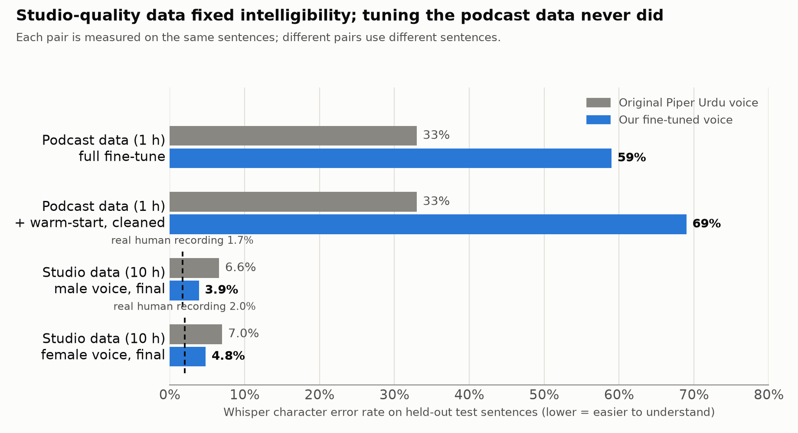
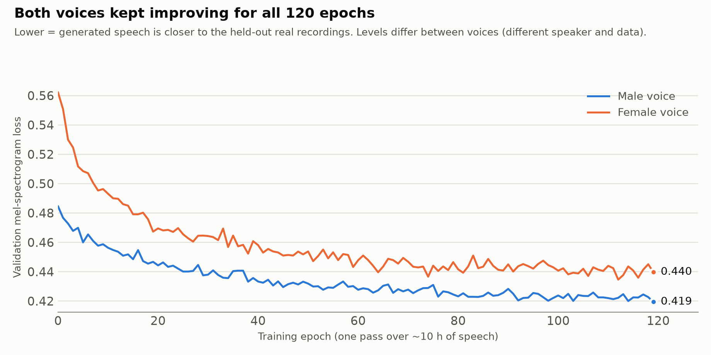

# Training a casual Urdu text-to-speech voice for BOL: summary

**Result in one line:** we fine-tuned two Urdu voices (male, female) from an existing Piper model on 10 hours of studio speech each; on held-out sentences a speech recogniser makes **31-41% fewer errors on our voices than on the original Piper Urdu voice** (male 3.9% vs 6.6%, female 4.8% vs 7.0%), and the voices run about 40× faster than real time on a CPU.

---

## 1. Goal

BOL is a voice-agent platform. Its agents needed a **natural, everyday Pakistani Urdu voice** (with English words mixed in, as people actually speak), trained by us, free to run, and fast enough for live calls. No hosted TTS was used: this is a final-year project, so the model is our own.

## 2. What we did

1. **Chose the model.** [Piper](https://github.com/OHF-Voice/piper1-gpl) (VITS architecture, "medium", 22.05 kHz): small enough to run on a CPU. We **fine-tuned the existing Piper Urdu voice** (`ur_PK-fasih-medium`, already trained for 3,206 epochs) instead of training from scratch.
2. **Found and prepared data.** Three datasets were tried (section 4). The final voices use [ai4bharat/Rasa](https://huggingface.co/datasets/ai4bharat/Rasa), studio-recorded Urdu: conversational, emotional and assistant-command styles only (formal reading, news and Wikipedia styles dropped).
3. **Cleaned the data:** resample to 22.05 kHz, trim silence, normalise loudness (-23 LUFS), reject clips that are too short/long, clipped or whose text length does not fit the audio, convert numbers to words, hold out 100 test sentences that are never trained on.
4. **Trained** on one RTX 5070 (12 GB) inside WSL2 for 120 epochs per voice (about 6 h male, 4.7 h female).
5. **Evaluated** with a speech recogniser (below), listening tests, and the training curves.
6. **Exported** to a 63 MB ONNX file per voice, served from a small HTTP service, and **added to BOL** as a selectable TTS provider with language Urdu.

## 3. ML method

| Part | What we used |
|---|---|
| Model | VITS (end-to-end text-to-waveform GAN). Training uses a 23.7 M-parameter generator and a 46.7 M-parameter discriminator; only the generator is deployed. |
| Text front end | eSpeak NG Urdu rules turn text into phonemes; English words are first spelled in Urdu script (a list of about 320 common words), because the Rasa data writes them that way. |
| Transfer learning | Start from the stock Urdu weights (weights only: fresh optimiser, fresh epoch counter), then fine-tune everything. |
| Optimisation | AdamW, learning rate 2e-4 (generator) / 1e-4 (discriminator), 3-epoch warm-up, decayed to 5% over the 120 epochs, batch 12. |
| Losses | Piper's VITS losses: mel-spectrogram L1, KL, duration, adversarial and feature-matching. We monitored the validation mel loss. |
| Intelligibility metric | Whisper large-v3-turbo transcribes our synthesised audio; we report the **character error rate (CER)** against the input text. Lower = easier to understand. Real human recordings score 1.7-2.0% on the same test, which is the floor. |
| Speaker separation | One dataset had four unlabelled narrators. We embedded clips with WavLM x-vectors (mean-centred) and clustered them with k-means into four voices. |

## 4. Experiments and what each taught us

Whisper CER, median (the original Piper voice scored 33% on the podcast test sentences):

| # | Data | Change | Result | Conclusion |
|---|---|---|---|---|
| A | URDUTTS audiobooks (92 h, 4 male narrators) | clustered into speakers, listened | not trained | Style is formal book narration; not the casual voice we wanted. |
| B | One podcast speaker, 1 h (compressed YouTube audio, machine-made transcripts) | full fine-tune, 475 epochs | **59%** | Words garbled. Degradation appeared within 2 epochs. |
| C | same | warm-start, half learning rate, warm-up, transcripts checked against Whisper (285 of 338 clips kept) | **66-69%** | No improvement: not a learning-rate or transcript-noise problem alone. |
| D | same | froze text encoder + duration predictor | 28% at epoch 2, but a listener heard distortion | Pronunciation kept, but the audio quality was poor. |
| E | same | also froze the decoder | judged worse by listening | Not fixed by freezing. |
| **F** | **Rasa male, 10 h studio** | warm-start full fine-tune (as in C, default learning rate), 120 epochs | **3.9%** (original voice 6.6%; test sentences differ from the podcast ones) | **Same kind of fine-tuning, much better data: it worked.** |
| **G** | **Rasa female, 9.5 h studio** | same as F | **4.8%** (original voice 7.0%) | Reproduced on a second speaker. |

**Takeaway:** four different fixes on 1 hour of noisy podcast audio all failed, while ordinary fine-tuning on 10 hours of clean studio audio worked the first time. We conclude that for a small VITS model the data, not the tuning, was the bottleneck. (We did not run a controlled test that isolates data size from data quality.)

## 5. Technical problems we hit and how we solved them

| Problem | Cause | Fix |
|---|---|---|
| Dataset name given in the plan did not exist | Real repo is `kaab4321/UrduTTS`, stored as 59 Arrow shards, no speaker labels | Wrote a shard downloader and the speaker-clustering step above. |
| Synthesis crashed on first run | Piper's editable install does not build its eSpeak phonemizer extension | Added the build step to the setup script. |
| Training crashed at the end of epoch 1 | New GPU (Blackwell, needs PyTorch 2.14) has no matching `torchaudio`, which Piper's MOS-based checkpoint callback needs | Small launcher that removes that callback and logs plain validation loss. |
| "Stop" command did nothing, then training restarted by itself | Background processes ignore Ctrl-C; a clean stop exits with code 1, which the auto-restart treated as a crash | Restore the signal handler; exit with code 130 on a deliberate stop. |
| ONNX export failed | New PyTorch default exporter cannot trace VITS's stochastic duration predictor | Use the TorchScript exporter. |
| Risk of losing days of training to a power cut | -- | A checkpoint every epoch, integrity check, 30-minute backups, a hidden Windows startup task that resumes automatically. **Tested by a real power cut: training resumed by itself once the PC was switched back on.** |
| Wrong pronunciations (السلام علیکم, صبح, دوپہر, and کیا read as "kya" when it means "kiya") | eSpeak's Urdu rules | Pronunciation lists (diacritic respellings, exact phonemes) plus a rule for کیا, applied in training text and at synthesis. |
| Evaluation numbers over 1000% | Whisper sometimes loops on one phrase | Block repeats, cap each clip at 100%, report the median. |
| BOL agent stayed silent after the greeting | LiveKit's streaming recogniser does not support Urdu | Urdu agents use Groq Whisper for speech recognition instead (implemented and unit-tested; a full live-call confirmation is still to do). |

## 6. Final results

| Held-out test (never trained on) | Real human | Original Piper voice | **Our voice** |
|---|---|---|---|
| Male, 100 Rasa sentences (CER, median) | 1.7% | 6.6% | **3.9%** |
| Female, 100 Rasa sentences (CER, median) | 2.0% | 7.0% | **4.8%** |
| 20 casual mixed Urdu/English lines, male / female | -- | 5.9% | **2.8% / 2.8%** |
| Speed (real-time factor on CPU; below 1 is faster than real time) | -- | 0.025-0.026 | **0.022-0.024** |

First audio in a BOL call arrives about 0.24 s after the text is sent.

## 7. Limits and next steps

- **Accent:** the Rasa speakers are Indian Urdu speakers, so the voices do not sound Pakistani. Informal listening by the project team (no formal panel) also found Piper "medium" clear but not yet "extremely realistic".
- **No formal listening test yet.** CER measures how understandable the speech is, not how natural it sounds.
- Small differences between the two voices: the male model was trained before the pronunciation lists existed; the female voice was exported at epoch 119 (validation loss 0.440) although epoch 112 was slightly better (0.435).
- **Next:** (1) record about 2 hours of a Pakistani female speaker (a 2,396-sentence casual script and a recording tool are ready) and fine-tune on it for the accent; (2) a blind listening test with 10-15 people (mean opinion score); (3) try a larger model (StyleTTS 2) for more natural speech; (4) a full live-call test in BOL.

## 8. Where things are

- `audio/` has the listening material: for each voice, 12 test sentences spoken by **the original Piper voice, the real human recording, and our voice** (same numbering in each), plus a 30-second paragraph and 20 casual lines; `audio/progress_timeline/` shows the same paragraph from the original voice, through the failed podcast experiments, to the final voices.
- `results/` has the raw evaluation output, the training curves and the scripts that produced them.
- Data: final voices use Rasa (CC BY 4.0; Varadhan et al., Interspeech 2024); the podcast experiments used ASLP UrduSpeech (CC BY 4.0). URDUTTS (CC BY-NC 4.0) was only explored, not trained on. Piper is GPL-3.0, so BOL talks to it over HTTP and never includes its code.
